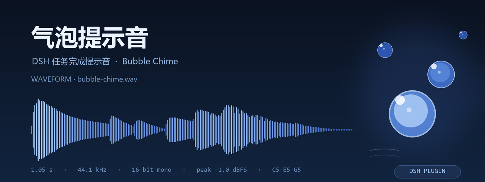

<div align="center">


# 气泡提示音

**`dsh-bubble`** —— 一个 DeepSeek Harness 插件：每完成一整个任务、输出停止后，冒一串「咕噜」气泡提示音。

<a href="https://github.com/cccchensy/dsh-bubble/stargazers"></a>


<a href="LICENSE"></a>

</div>



## ✨ 它做什么

仿 GPT 桌面版的「回答完成提示音」：不打扰，但让你立刻知道**这一轮真的跑完了**。

不是通用的 `ding`，而是一串气泡的声音：**低沉圆润的「咕噜」→ 两枚上浮气泡 → 水润的 C5–E5–G5 琶音 → 一点轻水花**，约 1.05 秒，温暖、圆润、不刺耳。全部由 numpy 程序合成，无任何外部采样。

## 🔊 马上试听

- 🎧 音频文件：[`assets/bubble-chime.wav`](assets/bubble-chime.wav)（1.05 s，mono 44.1 kHz）
- 📈 波形与测量：[`docs/bubble-card.png`](docs/bubble-card.png)
- 📐 合成参数与设计：[`assets/DESIGN.md`](assets/DESIGN.md) · 生成脚本：[`assets/synthesize.py`](assets/synthesize.py)

## 🎯 行为规则

| 场景 | 行为 |
| --- | --- |
| 一个会话从「运行中」变为「空闲」——整轮任务结束、输出停止（含期间所有多步工具调用） | **响一次** |
| 子代理 / Agent Teams 子会话逐个结束 | **不响**；整队只在主任务收尾时响一次，不会连环炸 |
| 多个会话几乎同时完成 | 700 ms 去重，只响一次 |
| 切到别的会话、停留在设置或插件页 | 照常响（监听挂在页面级浮层，与当前面板无关） |
| 页面刚打开、还没交互过 | 遵守浏览器自动播放策略；**第一次点击或打字后音频解锁**，之后每次都响 |
| 点击输入框下方的小泡泡按钮 | 静音 / 恢复（带斜线 = 已静音），状态记在 `localStorage` |

## 📦 安装

**前置**：DeepSeek Harness（测试于 Desktop `0.2.1-rc.3` 的 Web 界面）、Node.js ≥ 20、pnpm；需要 `git`。

### 方式一：直接从 GitHub 安装

```sh
dsh plugin --profile <你的 profile> add github:cccchensy/dsh-bubble
```

`dsh plugin` 会把参数转交给 pnpm；如果当前 pnpm 不接受 `github:` 短写，改用方式二。

### 方式二：克隆后按本地目录安装

```sh
git clone https://github.com/cccchensy/dsh-bubble.git
dsh plugin --profile <你的 profile> add link:<克隆目录的绝对路径>
```

### 方式三：让 DSH 自己装（桌面版最省事）

把下面这段发给任意一个 DSH 会话：

```text
帮我安装这个 DSH 插件：
1. 把 https://github.com/cccchensy/dsh-bubble 克隆到本地任意目录；
2. 用你的插件安装能力把这个目录作为 bundle 安装到当前 profile；
3. 装完提醒我按 Ctrl+Shift+R 硬刷新浏览器。
```

### 装完之后

1. **硬刷新浏览器**（`Ctrl/Cmd + Shift + R`）：浏览器只在启动时加载客户端模块；
2. 在 DSH 的 **Plugins 页面**确认 `dsh-bubble` 已启用（默认安装即启用）；
3. 随便发一条消息、等它跑完——任务结束时就会「咕噜咕噜」冒泡。

> 卸载：在 **Plugins 页面**停用或移除该 bundle 即可；音频与代码都随包移除，不写任何会话数据。

## ⚙️ 它是怎么工作的

很小的一个 **client-only bundle**（Host 半为空实现，不写 Session 事件、不注册模型工具、不发网络请求）：

- **完成检测**：订阅客户端 Remote 的 `api-session/status` 事件，并读取会话列表的状态源（`ctx.sessions.list`）作为兜底；某个会话 `running: true → false` 时触发一次。
- **子代理过滤**：会话列表行带 `origin` 字段，`origin === 'subagent'` 的行只记录状态、永不触发。
- **防误报**：挂载时先用当前状态播种（重载页面不会为历史完成补响），并对极短时间内的多次完成做 700 ms 去重。
- **播放**：WAV 以 data URI 内嵌在 `lib/client.js`（无网络请求），首次解码进 `AudioBuffer`；`AudioContext` 在第一次用户手势时解锁；Web Audio 不可用时回退到 `<audio>` 元素。
- **UI 注册**：`shell.overlay` 里挂一个不绘制的监听条目；`conversation.composer.dock` 里挂静音按钮，样式只使用宿主主题 token。

## 🎼 声音设计

| 层 | 内容 |
| --- | --- |
| 1 | 圆润低鸣「咕噜」：130 → 78 Hz 正弦 + 二次谐波，约 0.3 s 衰减，5 Hz 缓慢摆动 |
| 2 | 轻微水花：700–2400 Hz 带通白噪，65 ms，低电平 |
| 3 | 两枚上浮气泡：480 → 760 Hz、620 → 980 Hz，各 90 ms，6 Hz 颤音 |
| 4 | 水润琶音：C5 523.25 → E5 659.25 → G5 783.99 Hz，间隔 90 ms，±3 音分 / 6.5 Hz 颤音 |
| 5 | 收尾高音水花：1046 → 1568 Hz，70 ms，很轻 |

测得：1.0500 s，mono 44.1 kHz / 16-bit，峰值 −1.0 dBFS，RMS −13.4 dBFS，无 DC、无削波、首尾样本为 0，SHA-256 `f95c11f3…2068`；能量集中在 80–200 Hz 与 500–1200 Hz，3 kHz 以上几乎为零（不刺耳）。

## 🛠 开发

```sh
node scripts/build.mjs      # 校验 WAV → 内嵌 data URI → 生成 lib/client.js
node scripts/verify.mjs     # 结构 + 行为自检（manifest/patch/WAV/注册/响铃/静音/去重/兜底）

python assets/synthesize.py # 重新生成 WAV（确定性，哈希不变）
python docs/make-hero.py    # 重新生成 README 波形图
```

```text
dsh-bubble/
├─ package.json              # dsh.bundle.patch + dsh.client 清单
├─ cordis.patch.yml          # 一行 Host 条目（Host 端无行为）
├─ index.js                  # Host 半：空 apply
├─ src/client.template.js    # 浏览器半源码（音频占位符）
├─ lib/client.js             # 构建产物：内嵌 WAV 的浏览器半
├─ scripts/                  # build.mjs / verify.mjs
├─ assets/                   # bubble-chime.wav · synthesize.py · DESIGN.md
├─ docs/                     # bubble-card.png · make-hero.py
├─ locale/                   # 中英文插件管理页标题与描述
└─ icon.svg                  # 原创气泡图标
```

验证状态（2026-10-29）：`node scripts/verify.mjs` 全绿；独立只读审计 PASS；在 DSH Desktop `0.2.1-rc.3` 中实机确认两个 slot 条目 active。**限制**：agent 无法「听」音频，音色请以试听文件为准。

## ✅ 兼容性与已知限制

- 测试环境：DSH Desktop `0.2.1-rc.3`（Web 界面），Windows；`0.1.x` 未验证。
- 只在**页面打开**时播放；浏览器最小化/后台标签仍可发声，但页面关闭时不会响。
- 首次交互前受自动播放策略限制（这是浏览器规则，不是插件行为）。
- 已停止/被用户取消的任务同样算「输出停止」，会响一声（如需区分可在 `src/client.template.js` 的 `fireCompletion` 里扩展）。

## 🌐 English

A tiny DeepSeek Harness plugin that plays an original **bubbly chime** whenever a whole task finishes and the output stops. It watches the client-side session roster (`api-session/status` + `ctx.sessions.list`), ignores subagent-origin sessions, dedupes bursts, and plays a bundled 1.05 s WAV (embedded as a data URI, decoded once through Web Audio). A small bubble button under the composer mutes it.

```sh
dsh plugin --profile <profile> add github:cccchensy/dsh-bubble
# or: git clone … && dsh plugin --profile <profile> add link:<absolute path>
```

Then hard-refresh the browser (`Ctrl/Cmd + Shift + R`). MIT licensed; the chime is original program-generated audio.

## 📄 License

[MIT](LICENSE) © 2026 cccchensy. 提示音为程序合成原创音频，随仓库以同一许可提供。
